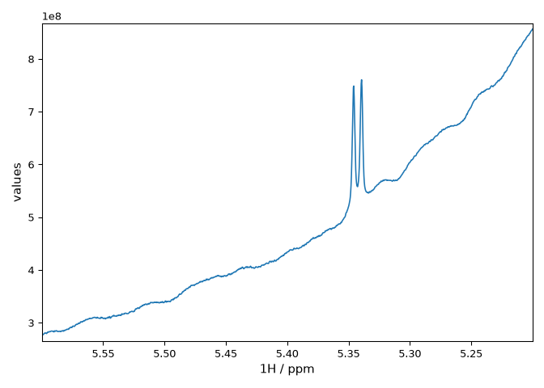

Choose a reader, a universal dictionary or interop
==================================================

.. list-table::
   :header-rows: 1
   :widths: 24 38 38

   * - Interface
     - What you get
     - When to use it
   * - Format reader
     - An array and a format-specific metadata dictionary.
     - Use an existing workflow, inspect source parameters or read with low memory.
   * - Universal dictionary (``udic``)
     - Common dimension descriptors such as size, width, carrier and domain.
     - Convert coordinates or configure a supported format conversion.
   * - ``nmrglue.interop``
     - Samples, axes, named components, metadata and diagnostics for supported profiles.
     - Pass data and explicit storage conventions to another library.

Read and normalize a spectrum
-----------------------------

Download the :download:`sample NMRPipe spectrum
<../../../tests/fixtures/fileio/data/nmrpipe_1d_freq.fid>` into your working
directory. Its header identifies it as a spectrum.

.. code-block:: python

    import nmrglue as ng

    result = ng.interop.read("nmrpipe_1d_freq.fid")
    spectrum = ng.interop.normalize(result)
    axis = spectrum.axes[0]
    print(result.format, spectrum.data.shape, axis.unit, axis.values[-1])

The reader detects the profile from the header. It returns a
:class:`~nmrglue.interop.ReadResult` with the decoded samples and source
metadata. Normalization returns a :class:`~nmrglue.interop.NormalizedAcquisition`
with a validated layout. Here it checks the axis calibration and preserves
the sample values. Other profiles may trim padding or combine quadrature
components and record the operations they applied.

Use the :ref:`interop-profile-table` to see what interop can read, when
to specify ``profile=``, and which results can be normalized. A storage
result remains usable when no normalizer is available.

Select a region in a Bruker spectrum
------------------------------------

This example passes a processed Bruker 1D sucrose spectrum to
``spectrochempy_nmr``. Install it in the same Python environment as
nmrglue-ng. See the
`spectrochempy_nmr interop reference <https://spectrochempy-nmr.readthedocs.io/latest/reference/interop.html>`_.

.. code-block:: console

    python -m pip install spectrochempy-nmr

Download the :download:`1r spectrum
<../../../tests/fixtures/fileio/data/bruker_pdata/exp1/pdata/1/1r>` and
:download:`procs parameters
<../../../tests/fixtures/fileio/data/bruker_pdata/exp1/pdata/1/procs>`.
Save both files under their original names in a folder named
``sucrose-pdata`` in your working directory.

.. code-block:: python

    from nmrglue import interop
    from spectrochempy_nmr import from_interop

    stored = interop.read_bruker_pdata("sucrose-pdata", read_acqus=False)
    spectrum = interop.normalize(stored)
    dataset = from_interop(spectrum)

    dataset.x = dataset.x.to("ppm")
    region = dataset[5.6:5.2]
    region.plot()

   The selected region as plotted by ``region.plot()``.

The processed parameters supply the frequency axis. The
``from_interop()`` function converts the normalized result into an
``NDDataset``. After converting its x
coordinate to ppm, the slice uses chemical shifts in the order of the
descending axis.

The sample is from the CC0 sucrose dataset in
`nmrXiv project P52 <https://doi.org/10.57992/nmrxiv.p52>`_.
